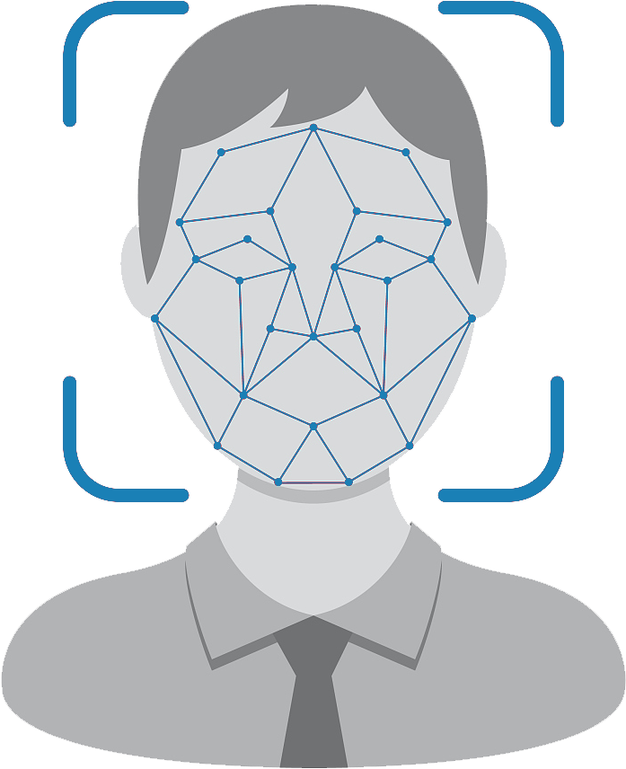
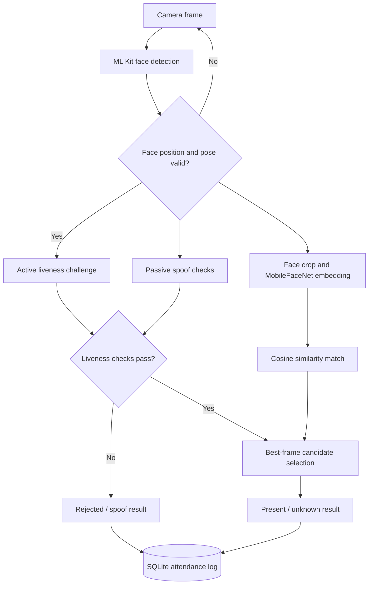

<div align="center">
  

  # FaceAuth
  **Offline Face Recognition & Liveness-Protected Attendance**

  A Flutter Android application for local face enrollment, live identity verification, spoof-resilient attendance, and searchable attendance history.

  
  
  
  
  
</div>

> **Platform status:** The supported experience is **Android**. Although the Flutter project contains platform scaffolding (including `web/`), its camera / ML Kit / native inference / SQLite flow has **not** been adapted or validated for Flutter Web. Do not treat this repository as a live web demo.

## Overview

FaceAuth is an offline-first attendance prototype that combines face embeddings with **active liveness challenges** and **passive anti-spoofing** checks. Recognition and storage are handled on the device rather than by a hosted recognition API.

The app is designed to demonstrate real-time computer vision integration, biometric matching, mobile application architecture, local persistence, and data visualization.

## Key features

| Area | Implementation |
| --- | --- |
| **Face enrollment** | Register a face locally; duplicate-face detection helps prevent repeat enrollment. |
| **Face recognition** | MobileFaceNet TensorFlow Lite model generates **192-dimensional**, L2-normalized embeddings; matching uses cosine similarity. |
| **Active liveness** | Guided blink → smile → turn left → turn right challenge, with neutral-pose transitions. |
| **Passive anti-spoofing** | Image-based TensorFlow Lite liveness model combined with a native detector and consecutive-frame checks. |
| **Candidate selection** | Scores multiple frames during the liveness challenge and uses the strongest candidate for the attendance result. |
| **Attendance history** | Local SQLite records for present, unknown, and spoof outcomes; configurable duplicate cooldown. |
| **Dashboard & reports** | Attendance summaries, seven-day trends, status filters, and CSV export. |
| **Configuration & diagnostics** | Adjustable matching and spoof thresholds, local data controls, and model/database diagnostic checks. |

## Technology stack

| Layer | Technology |
| --- | --- |
| UI | Flutter, Dart, custom Material design system |
| Face detection and face signals | Google ML Kit face detection |
| Face embeddings | TensorFlow Lite / MobileFaceNet |
| Liveness checks | Active camera challenges, TFLite liveness model, native anti-spoof detector |
| Data storage | `sqflite` / SQLite, SharedPreferences |
| Camera & imaging | `camera`, `image_picker`, `image` |
| Tests | `flutter_test` |

## Recognition flow



## Code structure

```text
face_auth/
├── android/                     Android app configuration and native host
├── assets/models/               Bundled TensorFlow Lite model files
├── images/                      UI background and logo
├── lib/
│   ├── main.dart                 Startup, settings and database initialization
│   ├── core/                    Theme, config, similarity and CSV helpers
│   ├── models/                  Attendance data models and aggregation
│   ├── services/                Face recognition, liveness, persistence
│   ├── screens/                 Result screen
│   ├── widgets/                 Reusable UI components
│   └── *_screen.dart             Dashboard, register, recognize, history, settings
├── test/                        Pure-logic tests
├── pubspec.yaml                 Dependencies and model assets
└── README.md                    Project documentation
```

## Getting started (Android Studio)

### Requirements

- Flutter SDK with **Dart 3.7 or newer**, Android Studio and the Flutter/Dart plugins.
- Android SDK configured and a physical Android device with a camera (recommended).
- Git, if you want to clone or contribute.

### Install and run

1. Clone the repository or download its ZIP from GitHub.
2. In **Android Studio → File → Open**, select the folder containing `pubspec.yaml`.
3. Open the **Terminal** tab in Android Studio, then run:

```bash
flutter doctor
flutter pub get
flutter devices
flutter run
```

4. Grant camera permission when prompted and test registration, live verification, and attendance logging on an Android device.

The model files expected by `pubspec.yaml` are:

```text
assets/models/mobilefacenet_ente_web.tflite
assets/models/liveness.tflite
```

If you distribute this repository publicly, confirm you have permission to redistribute these model weights. If the models are not included for licensing reasons, you must supply appropriately licensed compatible weights before running recognition.

### Run tests

```bash
flutter test
```

### Build an APK

```bash
flutter build apk --release
```

Output: `build/app/outputs/flutter-apk/app-release.apk`.

> **Signing note:** The project's current Android build script uses debug signing as a fallback if you have not configured a release signing key. For actual production distribution, create your own secure release keystore and keep `android/key.properties` and keystore files **outside Git**.

## Privacy and security considerations

- The main Android manifest requests camera access and declares no `INTERNET` permission.
- Enrollment data (including embeddings and face crops) and attendance records are stored locally.
- Android auto-backup is disabled in the main manifest.
- **Important:** local face data is not encrypted at rest by this project. Treat this as a technical demonstration rather than a production biometric identity system.
- Before using identifiable people's faces, obtain consent and provide data deletion procedures; do not commit real attendance databases or personal photos to GitHub.

## Current limitations

- **Android-focused:** browser deployment would require replacing/adapting native ML Kit, camera, TFLite, and SQLite integrations.
- **Model reliability:** face recognition accuracy, false acceptance/rejection rates, and anti-spoof reliability have not been independently benchmarked on a representative dataset.
- **Failure behavior:** liveness fallback behavior should be changed to fail closed for production use.
- **Security:** stored biometric templates and face images need encryption and a documented retention policy before use in a real institution.
- **Scalability:** the current approach scans locally enrolled embeddings; larger galleries may benefit from indexed nearest-neighbor search.

## Roadmap

- [ ] Add annotated screenshots and a short Android demo video
- [ ] Evaluate recognition and liveness on a documented test dataset
- [ ] Encrypt local biometric data and improve failure handling
- [ ] Improve accessibility and responsive layouts across Android form factors
- [ ] Develop a separate browser-compatible demo
- [ ] Add automated CI checks once the test suite is validated on the target Flutter SDK

## Acknowledgments and provenance

The supplied project archive included Git history referencing [hamza372/FlutterFaceRecognitionImages2026](https://github.com/hamza372/FlutterFaceRecognitionImages2026). Preserve relevant upstream attribution and verify that reuse and redistribution of upstream code, third-party libraries, and bundled ML model files are authorized before publishing this project publicly. Changes beyond that baseline are reflected in this project’s source code.

## License

The supplied project contains an [MIT LICENSE](LICENSE). The license covers only content that the stated copyright holder is authorized to license; external packages, models, images and reused upstream code may have separate terms.
